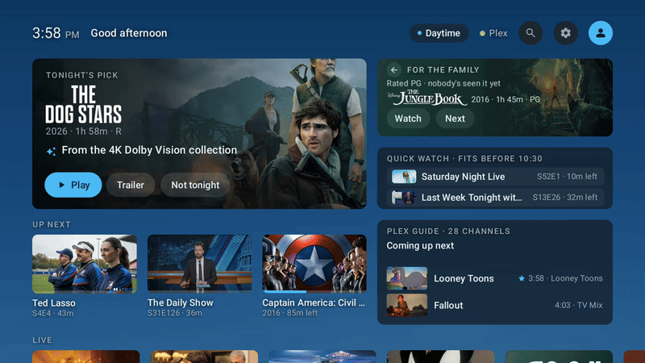
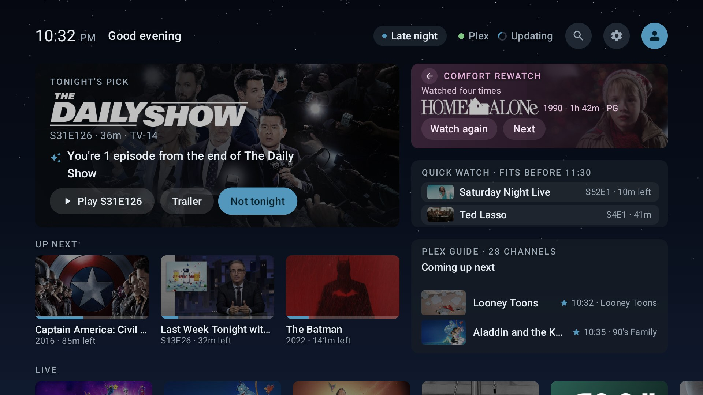
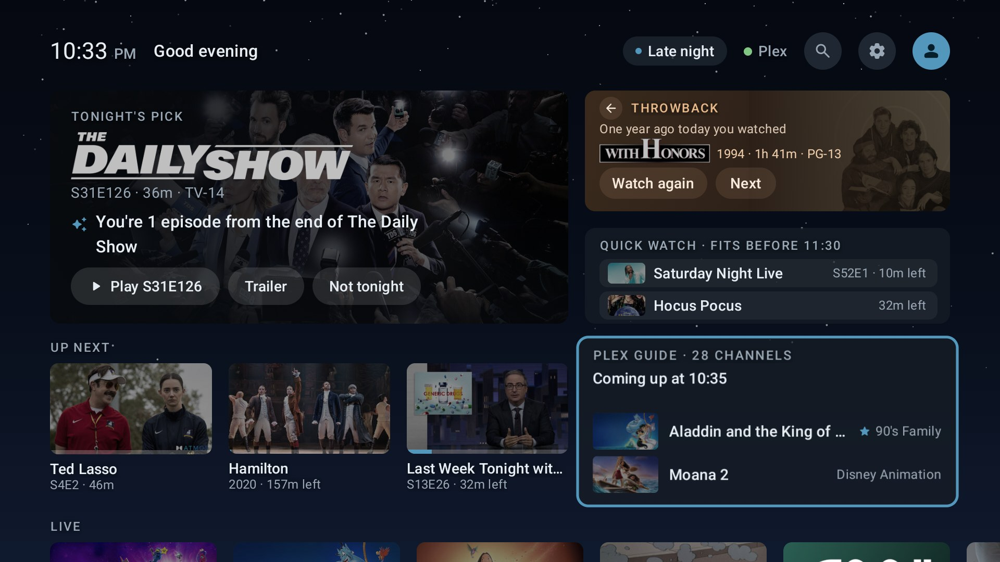
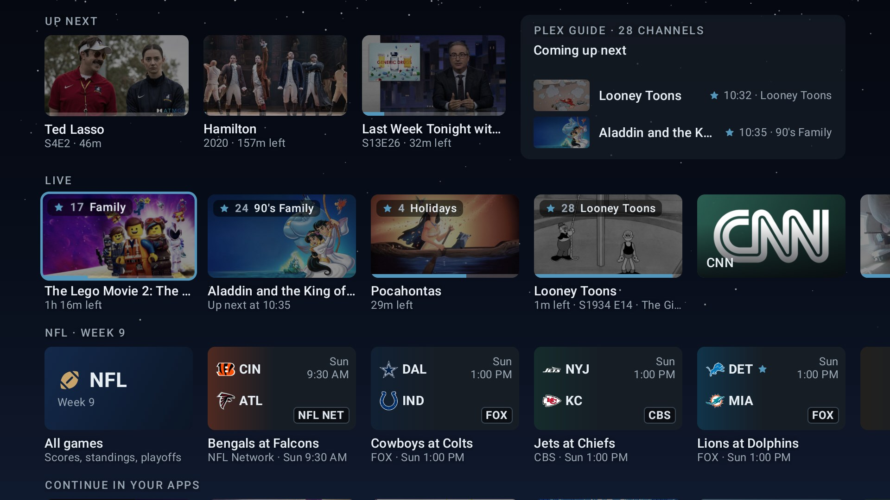
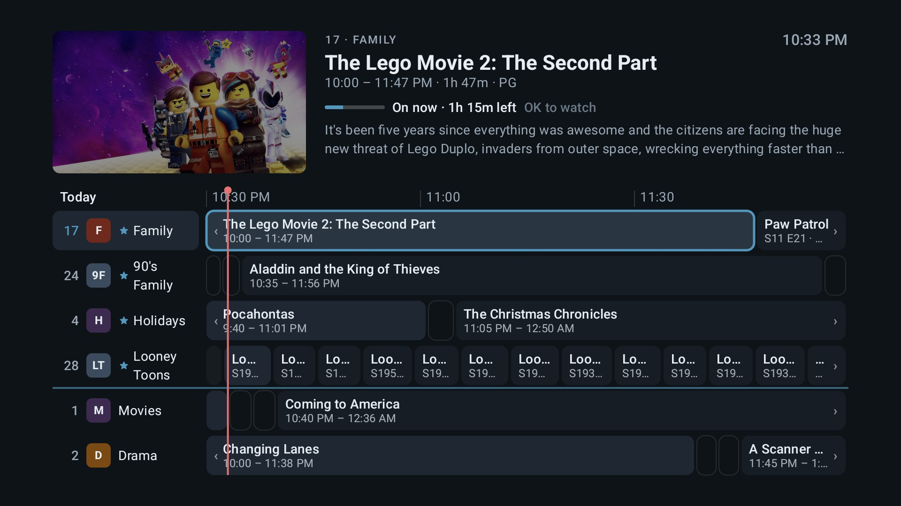
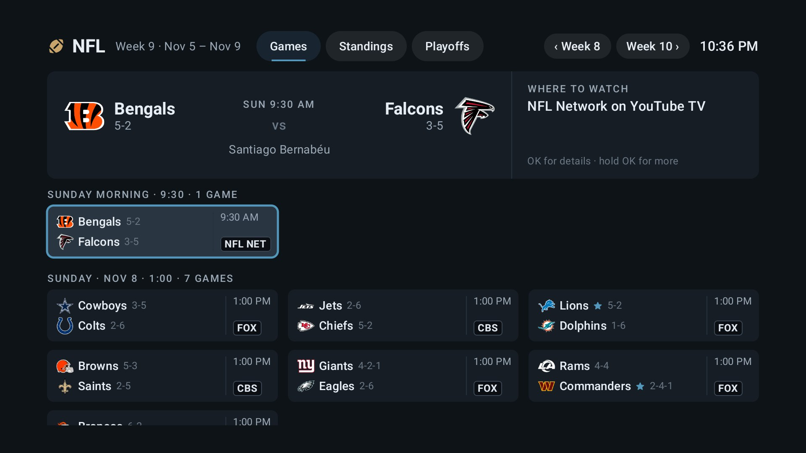
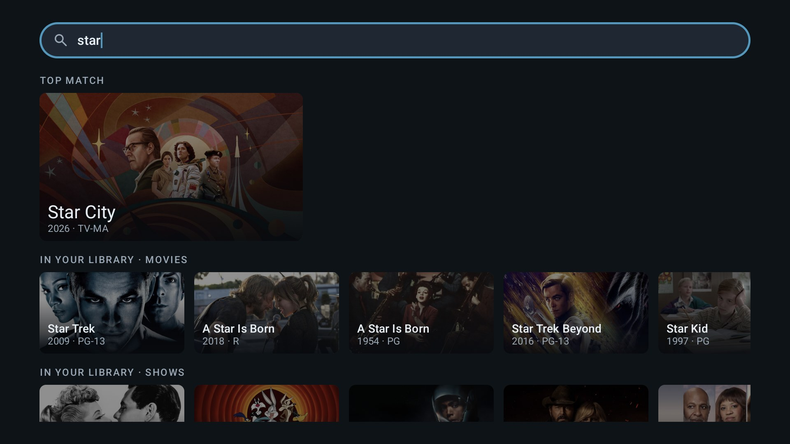
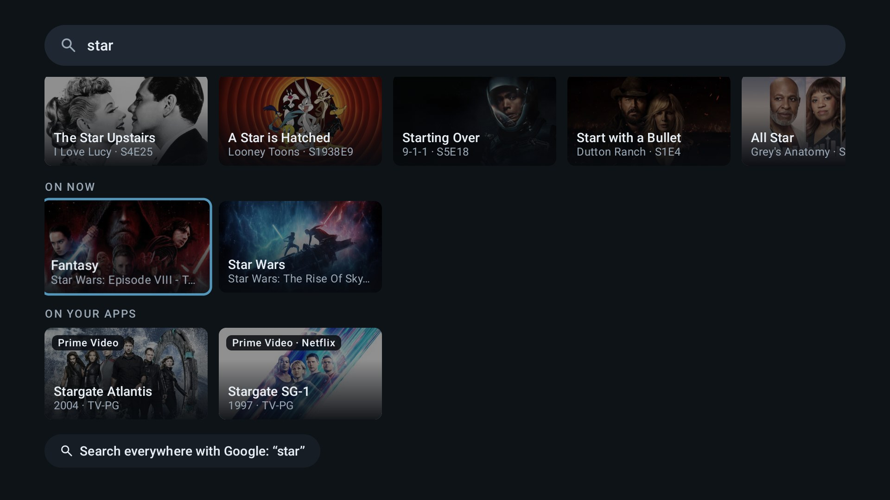

# Action Center (https://actioncentertv.com/)

An ad-free, card-based home screen for Android TV, built for the NVIDIA SHIELD TV. Instead
of rows of ads and app icons, it shows a few cards that answer "what should we watch
tonight?" from your own Plex library.



It's a hobby project, sideloaded over ADB. It isn't on the Play Store, and it isn't
affiliated with NVIDIA, Google, Plex or anyone else whose service it talks to (see
[Trademarks](#trademarks)).

## What it does

- **Tonight's Pick:** one title from your library, with the reason it was picked ("You're 2
  episodes from the end of the season"). **Not tonight** skips it and teaches the picker.
- **Throwback, Quick Watch and Up Next:** something you watched a year ago today, what fits
  before bedtime, and what you're most likely to carry on with.
- **The Plex Guide:** your library as live TV channels. It has a full guide and a mini
  guide, pause and start over, and audio and subtitle choice, and it plays inside the
  launcher. You can edit channels on the TV or from your phone.
- **The Live row:** your guide channels, then YouTube TV's networks.
- **Search:** one box that covers your library (through Plex's own search), what's on now,
  and titles on the streaming apps installed on this TV.
- **Profiles:** "Who's watching?" on wake. Kid profiles have a rating ceiling that moves up
  on each birthday, their own Plex user, and a kids' home.
- **The Apps row:** ordered by what you open at this time of day, with custom banners if you
  want them.
- **Optional extras:**
  - **The guide station:** one guide for every TV in the house
    ([do you need it?](docs/guide-station.md)).
  - **The NFL:** game-day cards, scores and standings from ESPN's public API. It's off until
    you turn it on in Settings › NFL (see
    [third-party notices](docs/third-party-notices.md)).
  - **AI blurbs:** one-sentence blurbs from Claude, using your own API key. They're off by
    default.
- **Hard to brick:**
  - A crash at startup opens safe mode, and All Apps and Settings are always reachable.
  - Every ADB change the scripts make prints its undo.

## Screenshots



**Late at night.** The same home in its late-night mode.

| | |
|---|---|
|  |  |
| **The home.** The lens card moves on by itself; here it's Throwback. | **Further down.** Your guide channels, YouTube TV's networks, and the week's games. |
|  |  |
| **The Plex Guide.** Your library as channels, with favorites first. | **The NFL.** Games by week, standings and the playoff picture. |
|  |  |
| **Search.** Your library first, through Plex's own search. | **Then** what's on now, what's on your streaming apps, and Google. |

These are real screens from a Google TV with a Plex library, at 1080p, and the GIF at the
top is the same TV, scaled down. The titles, artwork and logos belong to their owners.

## What you need

- **A TV device on Android TV 11 (API 30) or later, ARM 32- or 64-bit.** Tested on:
  - an NVIDIA SHIELD TV (SHIELD Experience 9.2.4, Android 11), set as its Home;
  - a Google TV set (Android 12, 32-bit). Google TV's own launcher has to stay on there, so
    Home reaches Action Center through an optional accessibility service.
- **A computer on the same network** with `adb` (Android SDK Platform-Tools). PowerShell 7
  is optional, for the helper scripts; it runs on Windows, macOS and Linux.
- **A Plex Media Server and a Plex account** for most of the cards. Without Plex, the cards
  wait for a sign-in, while the apps, the weather and Settings still work.
- **Optional:** an always-on Docker host for the guide station, such as a NAS or a mini PC.

## Install

The full guide is [`docs/install.md`](docs/install.md).

**No computer:**
1. Install the free Downloader app on the TV.
2. Download the latest release's `app-release.apk` with it.
3. Open Action Center and follow **Settings › Setup**, a checklist you can come back to.

**With a computer**, which gives the cleanest Home on a SHIELD, from a clone of this
repository:

```powershell
./scripts/connect.ps1 -Ip 192.168.1.50   # your TV's reserved IP; Network debugging on
./scripts/install.ps1 -Apk <path-to-apk> # or -Build to build it from source
./scripts/set-default-home.ps1           # SHIELD and stock Android TV only: see the guide
./scripts/grant-permissions.ps1          # usage stats, TV listings, your wallpapers
```

Each script that changes the TV shows the command and its undo, and asks before it runs.
`./scripts/rollback-home.ps1` puts your old Home back.

## Build from source

You need JDK 17 (Android Studio's bundled JBR is fine) and the Android SDK with platform 37.

```bash
./gradlew assembleDebug        # app/build/outputs/apk/debug/app-debug.apk
./gradlew lint testDebugUnitTest :guide-core:jvmTest :station:test assembleRelease   # what CI runs
```

On Windows, use `.\gradlew.bat`. Release builds are unsigned unless you set the
`RELEASE_*` environment variables (see [`CONTRIBUTING.md`](CONTRIBUTING.md)).

## How it's built

- **`app/`:** the launcher. Kotlin and Jetpack Compose for TV, with Room, DataStore,
  WorkManager, OkHttp and Coil, and Media3 ExoPlayer for the guide's player.
- **`guide-core/`:** Kotlin Multiplatform with no Android APIs. It holds the guide engine,
  the Plex client and the Plex cache, shared by the app and the station.
- **`station/`:** the optional guide station, a JVM service in a distroless container.
- **`scripts/`:** PowerShell 7 helpers for ADB, tested against a fake `adb`.

Every card renders from a local cache first; the network is never on the UI path. Release
builds check GitHub for a new release once a day. Settings › About picks what happens next:
install it by itself when the TV is idle, ask you first (the default), or not check at all. The
architecture sketch is in [`docs/roadmap.md`](docs/roadmap.md).

## Docs

| Doc | What |
|---|---|
| [`docs/install.md`](docs/install.md) | Installing, making it Home, updating, undoing it, troubleshooting |
| [`docs/guide-station.md`](docs/guide-station.md) | Whether you need the guide station, and how to run it on any Docker host |
| [`docs/security-and-privacy.md`](docs/security-and-privacy.md) | What the app stores, what leaves your TV, and the trust model |
| [`docs/product-brief.md`](docs/product-brief.md) | The design concept and feature set |
| [`docs/design/ui-spec.md`](docs/design/ui-spec.md) | The UI: tokens, geometry, the focus map, components |
| [`docs/design/guide-station-api.md`](docs/design/guide-station-api.md) | The station's HTTPS API |
| [`docs/roadmap.md`](docs/roadmap.md) | How it got here, phase by phase |
| [`docs/third-party-notices.md`](docs/third-party-notices.md) | Material the app uses but didn't write |

## Contributing and security

- **Contributing:** issues and pull requests are welcome; start with
  [`CONTRIBUTING.md`](CONTRIBUTING.md).
- **Security:** please report vulnerabilities privately, as
  [`SECURITY.md`](SECURITY.md) describes, not in a public issue.
- **Conduct:** see [`CODE_OF_CONDUCT.md`](CODE_OF_CONDUCT.md).

## Support the project

Action Center is free. If it makes your evenings better, you can buy me a coffee on
[Ko-fi](https://ko-fi.com/phonoodlesramen). Tips support the project as a whole; they don't
unlock anything.

## License

Action Center is free software, licensed under the
[GNU General Public License v3.0 or later](LICENSE) (GPL-3.0-or-later). You may use, study,
share and change it. If you share it, or something built from it, share the source under
the same licence.

This covers the app, `:guide-core`, the guide station and the scripts. The libraries it uses
keep their own licences, all compatible with GPL-3.0:
- NextLib's FFmpeg audio decoders are GPL-3.0, and FFmpeg itself, as NextLib builds it, is
  LGPL-3.0;
- the rest are Apache-2.0 or MIT-style.

See [`docs/third-party-notices.md`](docs/third-party-notices.md).

## Trademarks

NVIDIA and SHIELD are trademarks of NVIDIA Corporation. Android, Android TV, Google TV and
YouTube TV are trademarks of Google LLC. Plex is a trademark of Plex, Inc. NFL and team
names and logos belong to the NFL and its teams; ESPN is a trademark of ESPN, Inc. Claude
is a trademark of Anthropic, PBC. Action Center isn't endorsed by or affiliated with any of
them, and uses their names only to say what it works with.
